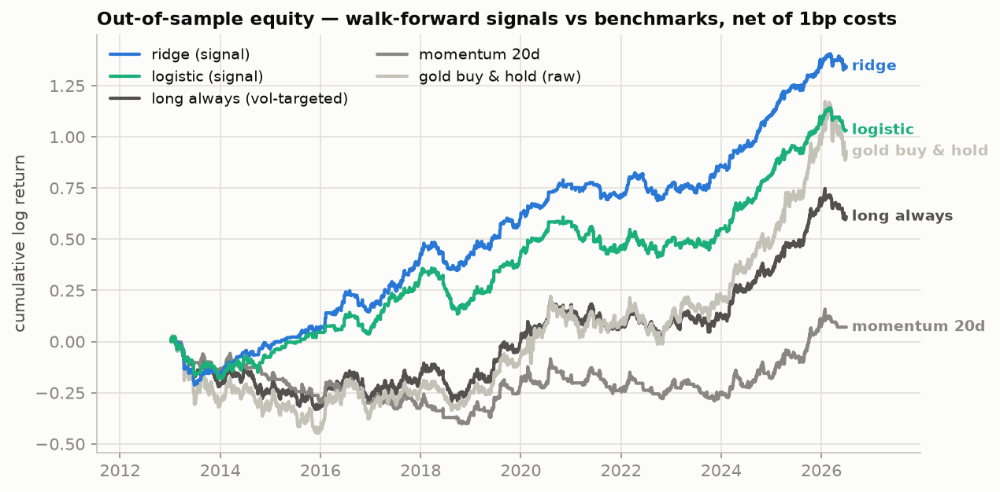
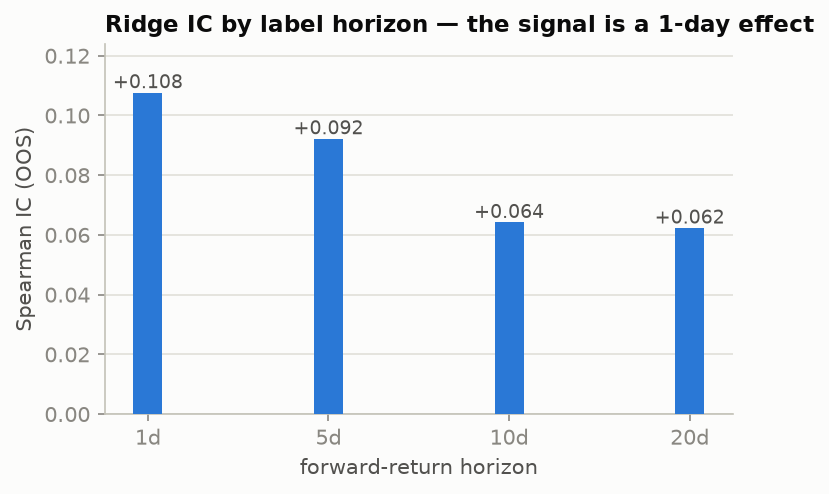
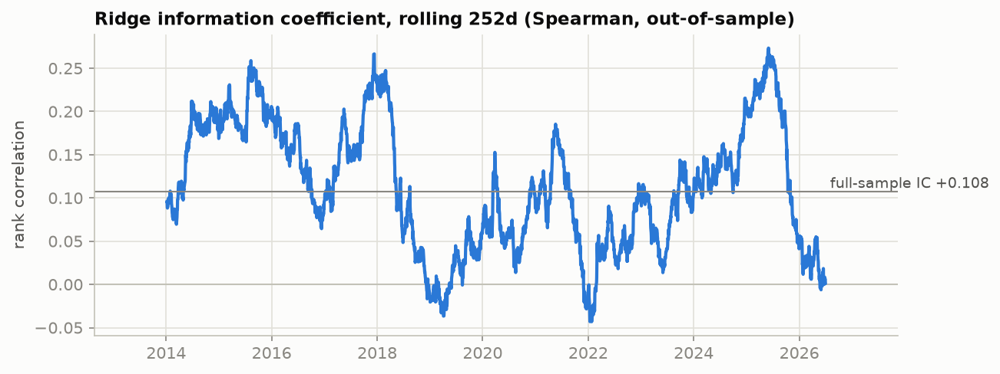
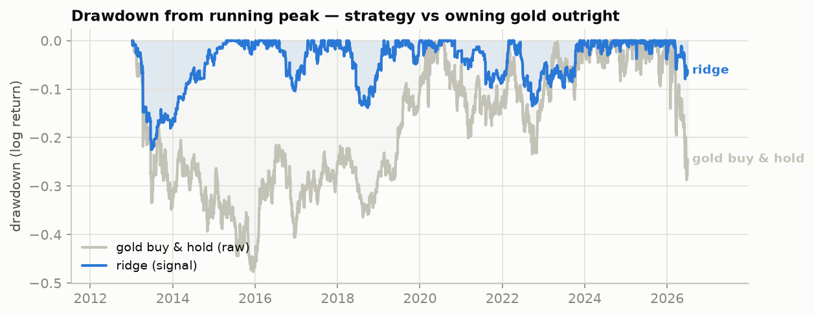
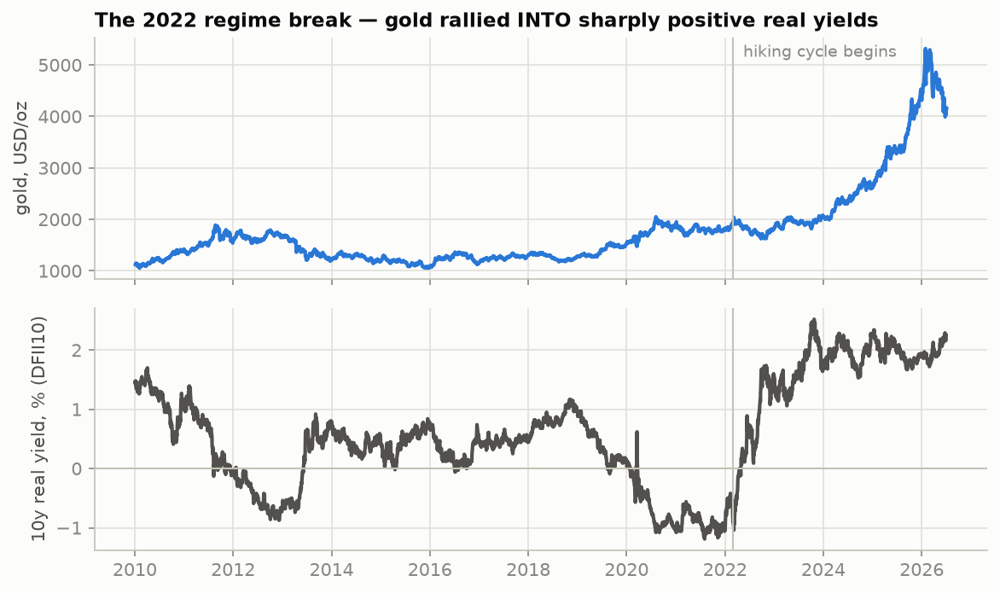

# Forecasting Gold at a One-Day Horizon with Free Public Data

*Research note — stages 1–6 of the gold-forecast project. Data through 2026-07-06;
all out-of-sample results 2013-01-07 → 2026-07-02. Research demonstration, not
investment advice or a live trading system.*

---

## TL;DR

A ridge regression on twenty leakage-audited features forecasts the **1-day**
forward COMEX gold return with an out-of-sample Spearman IC of **+0.108**
(walk-forward, 54 folds, 3,391 predictions over 13½ years). Run through a
long/flat strategy layer with a 10% vol target, a trailing stop, and 1bp
one-way costs, that thin edge compounds to **~10.0%/yr net at a Sharpe of
1.16**, against 0.40–0.41 for vol-targeted long gold and raw buy-and-hold, and
0.06 for a 20-day momentum rule. The breakeven cost is **21.7bp one-way** —
roughly 20× realistic gold-futures friction — so the result is not an artifact
of the cost assumption. Equally important negatives: the signal decays
monotonically with horizon (nothing beats naive at 20 days), and gradient
boosting **failed to beat the naive benchmark at every horizon** while
regularized linear models carried all the signal.

## 1. Data

Eight daily series, all free (stage 1; `reports/data_quality/report.md`):

| series | source | role |
|---|---|---|
| GC=F gold futures (target) | Yahoo Finance | continuous front-month close, 2010→ |
| SI=F silver, DX-Y.NYB dollar index, ^VIX, GDX miners | Yahoo Finance | cross-asset signals |
| DFII10 10y real yield, T10YIE breakeven | FRED | the textbook macro drivers |
| CPIAUCSL CPI | FRED | slow inflation trend |
| FOMC decision dates | federalreserve.gov | scheduled policy days |

Validation flags business-day gaps, stale runs, bad prints, and futures-roll
candidates; roll-day returns are neutralized rather than pretending a free
continuous ticker can be honestly back-adjusted. The FOMC calendar is scraped
from the Fed's own pages, keeps **decision days only**, and excludes
unscheduled/cancelled meetings — the flag claims to be known in advance, and an
emergency meeting is not.

## 2. Method — leakage is the whole game

With an IC this small, any look-ahead would swamp the true signal. Controls,
each enforced by a test or an audit rather than by assertion:

- **As-of convention.** A row dated *t* holds only information available at the
  close of day *t*; the label is the strictly-future forward log return. An
  empirical audit injects a price spike at an interior date and verifies **no
  feature before that date moves**.
- **Point-in-time macro.** Monthly CPI is shifted `(release_lag + 1)` months
  before daily forward-fill (conservative; exact vintages would need ALFRED).
  Daily FRED series are lagged one business day for their H.15 release.
- **Embargoed walk-forward.** Expanding train window, refit per fold, and the
  `horizon` rows straddling every train/test boundary are purged so no
  overlapping forward label crosses the split (López de Prado purging). A unit
  test asserts `last_train_day + N ≤ first_test_day` on every fold.
- **Fold-local fitting.** Imputer medians, scaler moments, and coefficients are
  fit inside each fold's training slice only.
- **Strategy timing.** A forecast made at close *t* earns the *t*→*t+1* return.
  Paired tests guard the classic backtest off-by-one: a clairvoyant signal must
  profit every day; a one-day-stale signal must earn nothing systematic.

Models (two heads on identical folds): naive benchmarks (predict zero / the
base rate), one-feature momentum baselines, ridge / logistic on all twenty
features, and XGBoost. Baselines must beat naive before ML is taken seriously.

## 3. Findings

**The signal is a 1-day effect.** Sweeping the label horizon re-runs the entire
walk-forward per horizon; ridge's IC decays monotonically from +0.108 (1d) to
+0.062 (20d), and at 20 days nothing beats the naive RMSE benchmark. This fits
the feature set — real-yield changes, VIX moves, momentum — which is fast
information with a short shelf life.

**At the 1-day horizon, both heads clear the naive gate** (the only horizon
where that is true):

*Regression head (forecasting the forward return):*

| model | RMSE/naive | IC (Spearman) | hit-rate |
|---|---|---|---|
| naive (predict 0) | 1.000 | — | — |
| momentum (1-feature) | 0.999 | +0.014 | 0.513 |
| **ridge** | **0.997** | **+0.108** | **0.537** |
| xgboost | 1.017 | +0.066 | 0.531 |

*Classification head (forecasting direction; OOS base rate 52.1% up):*

| model | accuracy | AUC |
|---|---|---|
| base rate | 0.521 | 0.489 |
| momentum logit | 0.521 | 0.489 |
| **logistic** | **0.543** | **0.545** |
| xgboost | 0.531 | 0.533 |

**Regularized linear models beat gradient boosting — everywhere.** XGBoost
(shallow, subsampled, regularized) still lost to naive on RMSE at every horizon.
On ~3,300 effective observations of a very low signal-to-noise target, tree
ensembles memorize noise faster than they find structure. This is reported as a
finding, not tuned away.

**The signal is persistent but not constant.** Rolling 252-day IC stays positive
for most of the sample but visits zero repeatedly — including a fade in the most
recent year. A thin edge that disappears for quarters at a time is exactly what
IC ≈ 0.11 means in practice.

## 4. From forecast to strategy

Positions are built **only from the stitched walk-forward OOS forecasts** — the
forecasts a live trader could actually have had. Pipeline: long/flat on the
signal sign → 10% annualized vol target (20d trailing, 2× leverage cap) → 10%
trailing-drawdown stop with a 5-day cooldown → 1bp one-way costs on all
turnover. Benchmarks run through the *identical* machinery, so differences are
signal, not plumbing.

| strategy | net/yr | Sharpe | max DD | avg \|pos\| | turnover/yr | b/e cost |
|---|---|---|---|---|---|---|
| **ridge (signal)** | **10.0%** | **1.16** | **22.5%** | 0.46 | 48× | **21.7bp** |
| logistic (signal) | 7.7% | 0.84 | 22.6% | 0.48 | 50× | 16.2bp |
| long always (vol-targeted) | 4.5% | 0.40 | 36.0% | 0.75 | 9× | — |
| momentum 20d | 0.5% | 0.06 | 40.5% | 0.40 | 24× | 3.2bp |
| gold buy & hold (raw) | 6.9% | 0.41 | 47.7% | 1.00 | ~0 | — |

Three observations worth making explicitly:

1. **The magnitude is consistent with the measured signal, not better than it.**
   Grinold's fundamental law caps a 0.108-IC daily signal near IC×√252 ≈ 1.7
   gross IR; a net 1.16 for a long/flat implementation (roughly half the
   breadth) sits inside that ceiling. If the backtest had produced Sharpe 3, the
   right response would have been to hunt for the bug.
2. **The edge survives its cost assumption by a wide margin.** Breakeven at
   21.7bp one-way vs ~0.5–1bp realistic GC friction. Contrast the momentum
   rule's 3.2bp — an "edge" that dies on any real desk.
3. **Most of the risk improvement is the exit, not the entry.** Ridge spends
   only 46% of days long and cuts the max drawdown from 48% (owning gold) to
   22% while *beating* buy-and-hold's return — through a sample that includes
   one of the strongest gold bull markets on record, which is a hard benchmark
   to beat by being out of the market half the time.

## 5. Structural context (not in the model, necessary for reading it)

**The 2022 real-rate regime break.** The textbook relationship — gold falls when
real yields rise, because a zero-yield asset's opportunity cost rises — visibly
broke in 2022–2024: the fastest hiking cycle in decades pushed 10-year real
yields from −1% to +2%, and gold *rallied*. The consensus attribution is
official-sector demand (below). For this project it means the model's
highest-conviction feature family (real-yield level, change, and rolling beta)
changed meaning mid-sample; the walk-forward's expanding window adapts slowly by
construction, and the rolling-IC dips around 2022 are consistent with that.

**Central-bank accumulation.** Central banks — concentrated in EM — have bought
at record rates since 2022 (~1,000t/yr, roughly a quarter of annual demand),
a structural bid that is price-insensitive and yield-insensitive. The data is
quarterly, lagged, and revised, so it cannot enter a daily model; it belongs
here, as the explanation for why the daily model's macro anchor weakened.

**Shariah note.** Gold investment is directly governed by AAOIFI's Shariah
Standard No. 57 on Gold (2016, developed with the World Gold Council). The
standard requires same-session settlement and possession (qabd, physical or
constructive) for gold transactions — physically-backed, allocated instruments
can comply; **deferred-settlement gold futures such as the GC contract modeled
here generally do not**. A Shariah-compliant implementation of this strategy
would need to trade a compliant vehicle (e.g. an allocated-gold ETC with
constructive possession), accepting tracking and cost differences versus the
futures assumed in the backtest.

## 6. Limitations — the honest list

- **One asset, one sample.** 13½ years of a single instrument; no cross-asset
  replication. The strategy's Sharpe carries wide error bars (roughly ±0.27 as
  a 1/√T standard error) and sample-specific regime luck cannot be excluded.
- **Idealized execution.** Daily-close fills, flat bps costs, no slippage,
  financing, or intraday effects. The 20× breakeven margin is the mitigation,
  not a proof.
- **Free-data constraints.** No true point-in-time macro (ALFRED vintages),
  no term structure, no positioning (CFTC COT is a natural next feature), no
  ETF flows, no intraday data. Roll handling neutralizes rather than
  back-adjusts, because honest back-adjustment needs per-contract prices.
- **No regime adaptation.** The expanding window never forgets; a model family
  with change-point awareness might handle 2022-style breaks better — or
  overfit to them.
- **Mild selection effects.** The 1-day horizon was chosen *on* the OOS sweep
  results reported here, and the strategy config (vol target, stop) was set a
  priori but not stress-tested across a grid. Both choices flatter the headline
  less than they could — the 5-day results also clear naive, and the stop/vol
  layer mostly reduces risk rather than adding return — but a fully
  out-of-sample protocol would nest that choice too.

## 7. Conclusion

Short-horizon gold is close to — but measurably not exactly — a random walk.
A leakage-controlled pipeline on entirely free data finds a small, persistent
1-day edge (IC ≈ 0.11) carried by regularized linear models on real-yield,
risk-sentiment, and momentum features, while gradient boosting finds nothing.
Passed through a realistic-but-idealized strategy layer, the edge is large
enough to survive its cost assumptions by an order of magnitude and to beat
owning gold outright on both return and drawdown. The result should be read as
a careful demonstration of *method* — the edge itself is thin, regime-dependent,
and would demand live-paper validation before anyone traded it.

*Reproduce: `python -m src.data_pull && python -m scripts.fetch_fomc_dates &&
python -m src.validate && python -m src.evaluate && python -m src.evaluate
--horizons 1 5 10 20 && python -m src.backtest && python -m src.plots`.*
